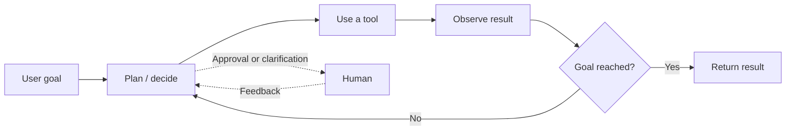
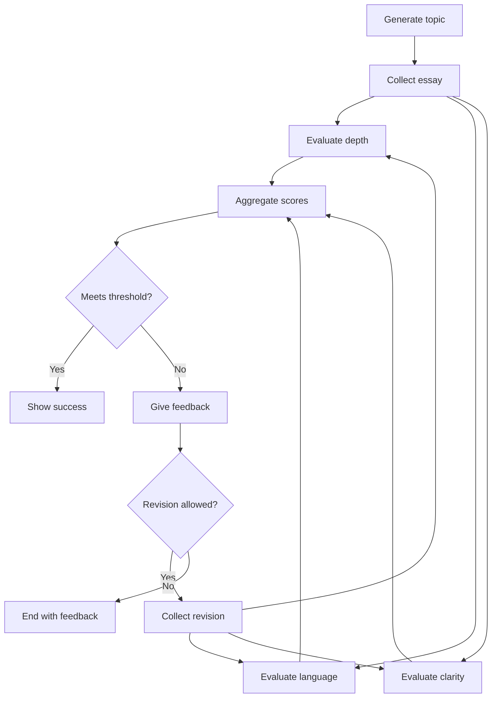
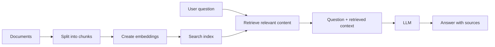

# Agentic AI · Learning Notes

> A practical guide to agents, orchestration, memory, tools, and retrieval-augmented generation.

**Start with the fundamentals → understand the workflow → explore retrieval.**

These notes were adapted from personal learning notes and edited for clarity. They are a conceptual guide, not production documentation. Framework APIs evolve; check the relevant version's documentation before implementing examples.

---

## Contents

- [01 · Agent fundamentals](#01--agent-fundamentals)
- [02 · Autonomy and safety](#02--autonomy-and-safety)
- [03 · Anatomy of an agent](#03--anatomy-of-an-agent)
- [04 · Workflows and multi-agent systems](#04--workflows-and-multi-agent-systems)
- [05 · LangChain and LangGraph](#05--langchain-and-langgraph)
- [06 · State, reducers, and execution](#06--state-reducers-and-execution)
- [07 · Persistence, streaming, and observability](#07--persistence-streaming-and-observability)
- [08 · Tools and human-in-the-loop](#08--tools-and-human-in-the-loop)
- [09 · Knowledge, fine-tuning, and RAG](#09--knowledge-fine-tuning-and-rag)
- [10 · Advanced retrieval](#10--advanced-retrieval)
- [11 · Python building blocks](#11--python-building-blocks)
- [12 · Chatbot learning roadmap](#12--chatbot-learning-roadmap)
- [13 · Projects to learn from](#13--projects-to-learn-from)
- [Quick glossary](#quick-glossary)

---

## 01 · Agent fundamentals

**Agentic AI** describes systems that pursue a goal by planning, using tools, observing results, and adapting their next actions with limited human intervention.

An LLM often supplies language understanding and decision-making, while the surrounding application controls execution, permissions, state, and stopping conditions.



### Core characteristics

| Characteristic | What it means |
| :--- | :--- |
| Autonomy | Make decisions and take actions within an approved scope. |
| Goal orientation | Choose actions that advance the objective and respect constraints. |
| Planning | Break a high-level goal into actionable steps. |
| Reasoning | Interpret information, evaluate alternatives, and make decisions. |
| Adaptability | Revise a plan when tools fail, feedback arrives, or conditions change. |
| Context awareness | Use task history, user preferences, environment state, and policies. |

### Goal orientation

A goal acts as a compass for the agent. It should be represented explicitly in instructions or task state, alongside constraints and success criteria. Goals can change, but the application must keep the active objective up to date.

### Planning and reasoning

During planning, an agent may decompose a goal, select tools, and estimate dependencies, effort, cost, and risk. During execution, it chooses actions, handles errors, and asks for help when uncertainty or impact is too high.

> **Useful distinction:** An agent chooses some of its next actions dynamically. A workflow primarily follows a predefined structure. Real applications often combine both.

## 02 · Autonomy and safety

Autonomy is a design choice—not an all-or-nothing feature.

### Control mechanisms

- **Permission scope:** Limit the tools, data, and actions available to the agent.
- **Human approval:** Add checkpoints before consequential actions.
- **Override controls:** Let users pause, stop, or redirect execution.
- **Guardrails:** Enforce validation rules and policy boundaries in the application.
- **Audit trails:** Record tool calls, outcomes, and concise decision rationales.

### Practical risk examples

| Scenario | Risk | Recommended control |
| :--- | :--- | :--- |
| Sending job offers | Incorrect salary or contract terms | Validate terms and require human approval before sending. |
| Shortlisting candidates | Discrimination or biased criteria | Restrict scoring to job-relevant criteria; audit outcomes and test for bias. |
| Buying recruitment ads | Unapproved spending | Enforce budget caps in the spending service; use read-only access when spending is unnecessary. |

Removing sensitive attributes from model inputs can reduce direct misuse, but **it does not eliminate bias**: other features may act as proxies. Fairness evaluation may require carefully governed access to sensitive data, separate from decision-making inputs.

### A reusable safety toolkit

1. Apply least privilege to every tool.
2. Validate inputs and outputs in code—not only in prompts.
3. Classify actions by impact and reversibility.
4. Require approval for high-risk or irreversible actions.
5. Log actions and monitor failures.
6. Set limits on steps, retries, time, and spending.

> **Important:** Prompts are not security boundaries. Tool implementations must enforce access restrictions and critical limits.

## 03 · Anatomy of an agent

### Model · the decision engine

Interprets instructions, proposes plans, evaluates trade-offs, and selects tools. The application determines what proposals can actually execute.

### Orchestrator · the execution layer

Coordinates sequencing, conditional routing, loops, retries, delegation, and stopping. Examples include LangGraph and other workflow or agent frameworks.

### Tools · the action interface

Expose capabilities such as web search, database queries, calculations, email, calendars, and business APIs.

### Memory and state · the continuity layer

- **Short-term memory:** Context for the current task or conversation.
- **Long-term memory:** Selected information persisted across sessions.
- **Workflow state:** Structured data describing progress and intermediate results.

Memory is not necessarily a complete conversation archive. Applications can retain selected facts, summaries, or records according to privacy and retention policies.

### Human oversight · the control layer

Approves consequential actions, resolves ambiguity, reviews outputs, and handles escalations. Automated guardrails complement—not replace—human oversight.

## 04 · Workflows and multi-agent systems

### Common workflow patterns

**Prompt chaining**

```text
Input → Step 1 → Validation gate → Step 2 → Final output
```

**Routing**

```text
Input → Router → Selected specialist → Output
```

**Parallelization**

```text
                  ┌→ Task A ─┐
Input ────────────┼→ Task B ─┼→ Aggregator → Output
                  └→ Task C ─┘
```

**Orchestrator–workers**

```text
Input → Orchestrator → Dynamically assigned workers → Synthesizer → Output
```

**Evaluator–optimizer**

```text
Input → Generator → Evaluator → Accept → Output
            ↑           │
            └─ Revise ──┘
```

Always give revision loops a stopping rule, such as a maximum number of iterations.

### Multi-agent systems

A multi-agent system assigns work to multiple specialized agents. It need not be fully autonomous: coordination may be predefined, supervised, or partially dynamic.

A research workflow might use:

1. **Search agent:** Finds relevant sources.
2. **Reader agent:** Extracts and organizes evidence.
3. **Writer agent:** Produces a structured draft.
4. **Critic agent:** Checks quality and proposes revisions.

Agents may share state or exchange messages. Shared memory requires explicit access rules, update semantics, and conflict handling.

**Project example → [Research Agent](https://github.com/16A9DA/researchAgent)**  
The README describes a four-stage LangChain pipeline: Tavily search → scrape a selected page → draft a structured report → critique the report. This is a concrete example of specialized roles in a coordinated workflow. The README does not establish a shared-memory system or an automatic revision loop; do not assume either is implemented.

### Suggested project structure

```text
project/
├── tools/       # External capabilities
├── agents/      # Agent definitions and instructions
├── workflows/   # Routing and orchestration
├── tests/       # Validation and evaluation
└── app.py       # Application entry point
```

### ReAct · reasoning + acting

ReAct interleaves task reasoning with actions and observations:

```text
Decide next step → Act → Observe → Decide next step → …
```

It is an agent design pattern, not the React UI library. User-facing logs can show actions, results, and concise rationales without exposing private internal reasoning.

## 05 · LangChain and LangGraph

### LangChain

LangChain supplies building blocks for LLM applications, including model interfaces, prompts, tools, retrievers, and agent abstractions.

Typical uses include conversational applications, summarization, RAG, and tool-using agents.

### LangGraph

LangGraph supplies graph-based orchestration for stateful workflows and agents. Nodes perform work; edges determine what runs next.

It supports patterns such as branching, loops, checkpointing, interrupts, and nested workflows. Some capabilities depend on configuration, a storage backend, or deployment infrastructure.

> **Mental model:** LangChain provides application components; LangGraph coordinates stateful execution. You can use LangGraph without relying on every LangChain component.

Avoid blanket claims that LangChain has no state, human-in-the-loop support, or fault tolerance. Modern LangChain agent functionality builds on LangGraph, and capabilities depend on the implementation and version.

## 06 · State, reducers, and execution

### Example · essay evaluation



### State

State is structured information carried through a workflow. In this example, it might contain:

```python
from typing import Annotated, TypedDict
from operator import add

class EssayState(TypedDict):
    topic: str
    essay_text: str
    depth_score: int
    language_score: int
    clarity_score: int
    total_score: int
    feedback: Annotated[list[str], add]
    evaluation_round: int
```

This is an illustrative state schema, not a complete runnable graph. TypedDict, dataclasses, or Pydantic models may be appropriate depending on the framework and validation needs.

### Reducers

A reducer specifies how an update is combined with an existing state value. A field can be replaced, appended to, or merged using a custom function.

In the example above, `add` concatenates feedback lists. An accumulating reducer needs deliberate reset or retention logic to avoid collecting stale feedback across revisions.

### Execution model

1. **Define the graph:** Declare state, nodes, and edges.
2. **Compile:** Validate and prepare the graph for execution.
3. **Invoke:** Provide the initial state and execution configuration.
4. **Run super-steps:** Active nodes execute and emit updates.
5. **Activate downstream nodes:** Routing determines subsequent work.
6. **Halt:** Execution ends when there is no further scheduled work, or an explicit stop condition is reached.

A super-step is an execution round, not necessarily one edge transition. Multiple eligible nodes may run in the same round.

### Message roles

- **SystemMessage:** Application instructions and behavior constraints.
- **HumanMessage:** User input.
- **AIMessage:** Model output, potentially including tool-call requests.
- **ToolMessage:** Results returned by a tool.

These roles represent structured conversation messages, not merely formatting tricks.

## 07 · Persistence, streaming, and observability

### Persistence

A checkpointer saves workflow state so it can be resumed or inspected later. Threads identify separate execution histories.

Typical benefits:

- Conversation continuity.
- Recovery from interruptions.
- Human approval and resumption.
- State inspection and replay, where supported.

An in-memory saver is useful for development, but its data generally disappears when the process stops. Use a durable backend when recovery across restarts matters.

> **Security note:** A thread identifier separates histories; it is not authorization. The application must verify that a user can access the requested thread.

Checkpointing also does not make external side effects automatically safe to repeat. Use idempotency controls for actions such as payments or sending messages.

**Project examples → [Bot](https://github.com/16A9DA/bot) · [Offline](https://github.com/16A9DA/offline)**  
Bot's README describes SQLite chat history organized by thread so conversations can be resumed. Offline's README describes SQLite storage for chats, messages, and memory. These demonstrate conversation persistence; the READMEs alone do not establish durable graph checkpoint recovery or authorization guarantees.

### Streaming

Streaming delivers incremental output instead of waiting for the entire response. Depending on the application, this may include tokens, state updates, or tool events.

Benefits include lower perceived latency, progressive UI updates, and opportunities to cancel work. Cancellation and actual cost savings depend on provider and application behavior.

### Observability with LangSmith

LangSmith supports tracing, debugging, and evaluation for LLM applications, including applications outside LangChain.

Traces can help inspect:

- Model inputs and outputs.
- Tool calls and failures.
- Node execution and routing.
- Latency and token usage.
- Conversation behavior.
- Prompt or model changes.
- Evaluation results before and after deployment.

Coverage depends on instrumentation. Custom application code needs tracing hooks if it is to appear in the trace. Redact secrets and sensitive data before logging.

## 08 · Tools and human-in-the-loop

### Tools

Tools let an agent act beyond text generation. Examples include search, calculation, retrieval, Python execution, email, calendar access, and custom APIs.

A typical tool loop is:

```text
Model requests tool → Application validates request → Tool executes
       ↑                                                  │
       └──────────────── Tool result ──────────────────────┘
```

In LangGraph, a prebuilt **ToolNode** can execute tool calls and return their results to the workflow. It does not eliminate the need for permissions, validation, and safe tool implementations.

### Human-in-the-loop · HITL

HITL places a person at important decision points to supervise, approve, correct, or redirect the workflow.

Common patterns:

- **Action approval:** Confirm before executing a consequential action.
- **Output review:** Edit or approve a draft before release.
- **Ambiguity clarification:** Ask when the objective or required information is unclear.
- **Escalation:** Hand off uncertain or exceptional cases.

The implementation must define what happens on approval, rejection, editing, timeout, and cancellation.

**Project example → [Bot](https://github.com/16A9DA/bot)**  
According to its README, Bot asks for confirmation before running a web search. Use this as a simple example of an action-approval checkpoint—not evidence that every tool or high-risk action is gated.

## 09 · Knowledge, fine-tuning, and RAG

### Training knowledge and cutoff

A model's pretrained knowledge comes from its training data and is not automatically refreshed. A stated knowledge cutoff is an approximate boundary, not a guarantee that the model knows every earlier fact.

### Fine-tuning

Fine-tuning updates model parameters using examples to influence behavior, style, format, or task performance.

- **LoRA:** Trains low-rank adapter parameters while keeping base model weights frozen.
- **QLoRA:** Uses low-rank adaptation with a quantized base model to reduce memory needs.

Fine-tuning is usually not the best way to maintain frequently changing facts. A fine-tuned model can still use retrieval and tools; these approaches are complementary.

### Knowledge base

A knowledge base is an information source, not a single technique. It may contain documents, databases, API-backed records, or a searchable index.

In a RAG application, the knowledge base often includes indexed document chunks and their metadata.

### RAG · retrieval-augmented generation

RAG retrieves relevant information at answer time and supplies it as context for generation.



### Why chunk documents?

- Fit embedding and generation context limits.
- Retrieve only relevant portions.
- Improve retrieval specificity.
- Keep prompts manageable.

Chunk size, overlap, document structure, and metadata affect retrieval quality. Chunking does not mean sending every chunk to the model one after another.

**Project examples → [Offline](https://github.com/16A9DA/offline) · [Bot](https://github.com/16A9DA/bot)**  
Offline splits uploaded documents into chunks and stores them in Chroma for search; its setup uses Ollama with `nomic-embed-text`. Bot answers questions from uploaded PDFs, uses Ollama's `nomic-embed-text` for embeddings, and identifies a PDF vector-store directory in its README; its installation includes FAISS. Both are practical entry points for exploring document retrieval.

> **RAG helps ground answers; it does not guarantee correctness.** Retrieval can miss evidence, sources can be wrong, and models can misinterpret the context. Citations should point to evidence that actually supports the answer.

### Temperature

Temperature influences sampling randomness. Lower values are often useful for consistency; higher values can increase variation. Supported ranges and behavior vary by model.

A temperature of zero is not a factual-accuracy guarantee, and a temperature of one does not automatically produce good creativity.

## 10 · Advanced retrieval

### Query translation

Rewrite or transform a question to make it easier to retrieve useful evidence.

- **Rephrasing:** Make the wording clearer or more search-friendly.
- **Expansion:** Add relevant terms or synonyms.
- **Decomposition:** Split a complex question into smaller questions.
- **Multi-query retrieval:** Generate several formulations of the same information need.
- **Step-back prompting:** Retrieve broader concepts that help answer a specific question.
- **HyDE:** Generate a hypothetical document, embed it, and use that representation for retrieval.

A hypothetical HyDE document is a search aid—not factual evidence.

> If the request is genuinely ambiguous, ask for clarification. Query rewriting cannot reliably infer an unstated intention.

### RAG fusion and reciprocal rank fusion

RAG fusion combines results from multiple queries. **Reciprocal Rank Fusion (RRF)** combines ranked lists using each document's position rather than requiring directly comparable similarity scores.

```text
RRF score(document) = sum over lists of 1 / (k + rank(document))
```

Here, `k` is a smoothing constant. Documents ranked highly across multiple lists receive stronger combined scores.

### Re-ranking

Re-ranking reorders an initial set of retrieved candidates to improve relevance before selecting context.

Common approaches include:

- **Cross-encoder re-ranking:** Scores query–document pairs together.
- **LLM-based re-ranking:** Uses a model to assess relevance; adds cost and latency.
- **Late-interaction scoring:** Uses token-level representations, as in ColBERT-style retrieval.

Re-ranking is different from rank fusion: fusion combines result lists; re-ranking evaluates or reorders candidates.

### IR-CoT · interleaving retrieval and reasoning

IR-CoT interleaves reasoning with retrieval, often for multi-hop questions requiring evidence from multiple sources.

```text
Question → Retrieve → Read / reason → Retrieve again → Synthesize answer
```

Use limits on retrieval rounds and verify the evidence at each stage.

### Routing

- **Logical routing:** Choose a source or workflow based on explicit rules or model classification.
- **Semantic routing:** Compare embeddings with route representations and select a suitable destination.

### Query structuring

Convert natural language into a structured query or filter—for example, a date range, metadata filter, or validated SQL query. Generated queries still need validation and access controls.

### Propositional indexing

Index small, self-contained facts extracted from documents. This can make retrieval more precise, while links to original sources preserve context and provenance.

### RAPTOR

RAPTOR builds a hierarchical retrieval structure by clustering related text chunks, summarizing the clusters, and repeating the process at higher levels.

The result is a tree containing both detailed content and higher-level summaries. Summary quality and source traceability remain important.

### ColBERT

ColBERT represents queries and documents with token-level embeddings and uses late interaction to score relevance, rather than compressing an entire document into one vector.

## 11 · Python building blocks

### Asynchronous programming

Asynchronous programming lets a program yield while waiting for operations such as network requests, enabling other work to proceed. Python's `asyncio` is a common library for this pattern.

**Concurrency is not the same as parallelism.** Async code can overlap waiting without executing CPU-bound Python work simultaneously across multiple cores.

### Pydantic

Pydantic validates and parses data using Python type annotations.

Useful capabilities:

- Structured schemas and validation.
- Type coercion where permitted.
- Strict validation where configured.
- Detailed validation errors.
- JSON Schema generation.

Pydantic v2 uses a Rust-based validation core. Type annotations alone do not validate arbitrary Python data at runtime; validation occurs when the relevant Pydantic machinery is invoked.

## 12 · Chatbot learning roadmap

- [ ] Build a simple conversation workflow.
- [ ] Define message and task state.
- [ ] Add checkpointing and separate conversation histories.
- [ ] Implement authorization for history access.
- [ ] Stream responses and workflow events.
- [ ] Resume an existing conversation.
- [ ] Use a durable storage backend.
- [ ] Build a user interface.
- [ ] Add tools with permission and validation checks.
- [ ] Add human approval for consequential actions.
- [ ] Instrument traces and review failures.
- [ ] Evaluate quality, safety, latency, and cost.

---

## 13 · Projects to learn from

These examples are based on each repository's README, retrieved on **12 October 2026**. Their implementation, dependencies, and runtime behavior have not been audited or tested here. Follow the upstream README for current setup instructions.

### A · Bot — a tool-using chatbot

[Explore repository →](https://github.com/16A9DA/bot)

**Best fit in these notes:** LangGraph, tools, chat persistence, PDF retrieval, and human approval.

The README describes a LangGraph chatbot with a Streamlit UI, Groq-hosted inference, SQLite history, web search, math, and uploaded-PDF question answering. PDF embeddings use a local Ollama model.

```text
Streamlit / terminal → LangGraph chatbot
                           ├→ Groq model
                           ├→ Web search with confirmation
                           ├→ Math
                           ├→ PDF retrieval
                           └→ SQLite conversation history
```

**Start here**

1. Follow the repository's dependency installation instructions.
2. Configure `GROQ_API_KEY` and `TAVILY_API_KEY` in a local `.env` file.
3. Run Ollama locally and pull `nomic-embed-text` for PDF embeddings.
4. Launch the UI:

   ```bash
   streamlit run app.py
   ```

   Or use the terminal entry point:

   ```bash
   python bot.py
   ```

**Files to read:** `bot.py` for the graph, tools, and chat logic; `app.py` for the UI. The README identifies `bot.db` and `fiass_db` as untracked storage. The latter spelling is copied from the README.

**Learning exercise:** Trace a PDF question through retrieval, then trace a web search through the approval checkpoint. Check how conversation threads are selected and stored.

### B · Offline — local inference, documents, and memory

[Explore repository →](https://github.com/16A9DA/offline)

**Best fit in these notes:** Local model execution, memory, RAG, and application structure.

The README describes a locally running assistant using Ollama's `qwen3.5:9b`, LangGraph, and LangChain. It stores conversations and memory in SQLite and uploaded-document chunks in Chroma. Optional Tavily web search requires a network connection.

```text
Local web UI → LangGraph / LangChain agent → Ollama
                          ├→ SQLite chats and memory
                          ├→ Chroma document retrieval
                          ├→ Basic math
                          └→ Tavily search when online
```

**Start here**

1. Install Python 3.10+ and the dependencies listed in the README.
2. Run Ollama locally with `qwen3.5:9b` and `nomic-embed-text` pulled.
3. Optionally configure `TAVILY_API_KEY` for online search.
4. Start the application:

   ```bash
   python app.py
   ```

5. Open `http://localhost:8000`.

**Files to read:** `agent.py` for agent setup; `tools.py` for tools; `rag.py` for document ingestion; `database.py` for storage models; `app.py` and `templates/` for the web application.

**Learning exercise:** Follow an uploaded document from ingestion to retrieval, and identify what information is stored as conversation history versus longer-term memory.

> **Local does not mean every feature is offline.** The README says the chatbot works without internet after setup, but Tavily web search still needs connectivity. This is not a security or privacy audit.

### C · Research Agent — a staged research pipeline

[Explore repository →](https://github.com/16A9DA/researchAgent)

**Best fit in these notes:** Task decomposition, specialized roles, orchestration, and evaluation.

The README describes a local-LLM LangChain pipeline with four stages:


The writer produces an introduction, basic knowledge, deep knowledge, and a conclusion. The critic provides a score, strengths, and areas for improvement.

**Start here**

```bash
pip install -r requirements.txt
streamlit run streamlit_app.py
```

Set the research topic as described upstream. The README does not provide full model or credential configuration details.

**Files to read:** `agents/llm.py` for agent and chain definitions; `tools/tools.py` for search and scraping; `pipeline/pipeline.py` for coordination.

**Documentation caveat:** The usage instructions name `streamlit_app.py`, while the project-structure block names `app.py` as the web UI entry point. Confirm the actual filename in the repository before running it.

**Learning exercise:** Trace how evidence moves from the search and reader stages into the report. Check whether the critic's feedback triggers any revision—its README describes critique, not an automatic feedback loop.

### Suggested learning order

**Bot → Offline → Research Agent**

Begin with conversational state and tool approval, then explore local inference and document memory, and finally study a specialized-role research workflow. This is an editorial learning path, not a ranking of project quality.

**Keep secrets out of Git:** Never commit `.env`, API keys, private chat databases, or uploaded documents. Review a repository's ignore rules before committing generated data.

---

## Quick glossary

| Term | In one sentence |
| :--- | :--- |
| Agent | A system that selects actions to advance a goal. |
| Workflow | A structured sequence or graph of tasks. |
| Orchestrator | The layer coordinating execution and routing. |
| State | Structured data carried through a workflow. |
| Reducer | A rule for combining state updates. |
| Checkpoint | A saved snapshot of execution state. |
| Tool | An external capability exposed to the application or agent. |
| HITL | Human oversight at selected points in the workflow. |
| Embedding | A numerical representation used for similarity and retrieval. |
| RAG | Retrieval of evidence followed by context-grounded generation. |
| Re-ranking | Reordering retrieved candidates by relevance. |
| Observability | Visibility into application behavior through traces, metrics, and logs. |

---

### Contributing

Corrections and clearer examples are welcome. When proposing a change, explain the concept being corrected and include supporting documentation where possible. Never commit API keys, credentials, or private conversation data.
